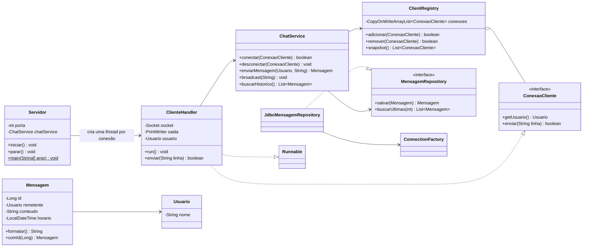

# Chat Multiusuário com Histórico

Projeto de Programação Orientada a Objetos (Java) — 2º bimestre, Opção A.

Sistema cliente-servidor em Java no qual vários clientes se conectam ao
mesmo servidor, trocam mensagens por broadcast e recebem, ao entrar, as
últimas mensagens salvas no banco de dados.

## Tecnologias

- Java: código compilado para Java 21 (JDK 26 no ambiente de desenvolvimento).
- Maven.
- Sockets TCP e uma thread por cliente.
- JDBC com banco H2 (arquivo local `data/chat`).
- JUnit 5.

## Requisitos atendidos

| Requisito | Onde |
|---|---|
| Servidor com `ServerSocket` e laço de `accept()` | `server.Servidor` |
| Uma thread por conexão | `Servidor.iniciar()` |
| Atendimento que implementa `Runnable` | `server.ClienteHandler` |
| Coleção de clientes protegida para acesso concorrente | `service.ClientRegistry` |
| Broadcast para todos os conectados | `ChatService.broadcast()` |
| Mensagem com remetente, conteúdo e horário | `model.Mensagem` |
| Persistência via JDBC | `persistence.JdbcMensagemRepository` |
| Repository isolando o SQL | `model.MensagemRepository` + `persistence` |
| Histórico enviado ao conectar | `ChatService.conectar()` |
| Desconexão segura | `finally` do `ClienteHandler` |
| Mínimo de 5 testes sem rede/banco | 26 testes unitários |
| Pacotes separados | ver Arquitetura |

## Rubrica de avaliação

| Critério | Pontuação |
|---|---:|
| Múltiplos clientes simultâneos | 1,3 |
| Broadcast sem perder mensagens | 1,2 |
| Persistência JDBC | 1,0 |
| Pacotes e responsabilidades | 0,5 |
| Testes unitários | 0,5 |
| Código e relatório | 0,5 |
| Total | 5,0 |

## Arquitetura

Pacote base: `br.com.luka.chat`.

| Pacote | Conteúdo | Pode importar |
|---|---|---|
| `model` | `Usuario`, `Mensagem`, `MensagemRepository` (interface), exceções | nada de infraestrutura |
| `service` | `ChatService`, `ClientRegistry`, `ConexaoCliente` (interface) | `model` |
| `persistence` | `JdbcMensagemRepository`, `ConnectionFactory` | `model`, `java.sql` |
| `server` | `Servidor`, `ClienteHandler`, `Protocolo` | `service`, `model`, `java.net` |
| `client` | `ClienteChat` | apenas rede |

Regra prática: socket não conhece SQL, repository não conhece socket,
o domínio não conhece nenhum dos dois e o serviço conecta as partes.
As implementações concretas são criadas apenas no `main` do `Servidor`
e injetadas pelo construtor.



### Fluxo de uma mensagem

1. `ClienteChat` envia uma linha UTF-8 pelo socket.
2. `ClienteHandler.run()` lê a linha e chama `ChatService.enviarMensagem()`.
3. O serviço cria a `Mensagem`, que valida o conteúdo no construtor.
4. A mensagem é salva com `MensagemRepository.salvar()` (JDBC).
5. O serviço faz o broadcast para um snapshot dos clientes conectados.

Ao conectar, a primeira linha do cliente é o nickname. Se for válido e
estiver livre, o cliente recebe as últimas 20 mensagens e os demais
recebem o aviso `* nome entrou no chat`.

## Concorrência

| Objeto compartilhado | Proteção |
|---|---|
| Lista de clientes (`ClientRegistry`) | `CopyOnWriteArrayList`; o broadcast itera sobre um snapshot, sem lock durante a escrita nos sockets |
| Nickname único | verificar e adicionar sob o mesmo lock (check-then-act atômico) |
| `PrintWriter` de cada cliente | `enviar()` é `synchronized`, então as linhas não se intercalam |
| Ordem das mensagens | salvar e fazer o broadcast em uma única seção crítica, para que o banco e os clientes vejam a mesma ordem (custo: menos paralelismo nos envios) |
| Banco de dados | uma `Connection` por operação, fechada com try-with-resources |
| `Mensagem` e `Usuario` | imutáveis; circulam entre threads sem lock |

Race conditions tratadas:
- **Nickname duplicado**: dois clientes com o mesmo nome ao mesmo tempo.
  Testado com 20 threads disputando o nome.
- **ConcurrentModificationException no broadcast**: evitada pelo snapshot.
- **Ordem salvar/broadcast divergente**: evitada pela seção crítica única.

Se o envio para um cliente falhar, só esse cliente é removido; os demais
continuam recebendo. Uma queda abrupta do cliente cai no `finally` do
`ClienteHandler` e não afeta o servidor.

## Persistência

Script em [`src/main/resources/schema.sql`](src/main/resources/schema.sql),
executado automaticamente ao iniciar o servidor:

```sql
CREATE TABLE IF NOT EXISTS mensagem (
    id        BIGINT AUTO_INCREMENT PRIMARY KEY,
    remetente VARCHAR(30)  NOT NULL,
    conteudo  VARCHAR(500) NOT NULL,
    horario   TIMESTAMP    NOT NULL
);
```

- Sempre `PreparedStatement` e try-with-resources.
- Convenção do id: a mensagem nasce com id nulo; o repository devolve uma
  nova instância com o id gerado.
- `SQLException` é convertida em `PersistenciaException`, para que
  `java.sql` não chegue às camadas de serviço e rede.
- Avisos de entrada e saída não são persistidos.

## Como executar

Requer Java 21 ou superior. Os scripts encontram automaticamente um JDK
compatível (via `JAVA_HOME`, o JDK conhecido ou o `PATH`) e montam o
classpath com o driver H2.

```powershell
# Terminal 1 – servidor (use -Compilar na primeira vez ou depois de mudar o código)
.\scripts\servidor.ps1 -Compilar

# Terminais 2, 3, 4 – clientes
.\scripts\cliente.ps1
```

- Para outra porta: `.\scripts\servidor.ps1 6000`.
- Se o PowerShell bloquear scripts:
  `Set-ExecutionPolicy -Scope CurrentUser RemoteSigned`.
- No cliente, digite o nickname, depois as mensagens; `/sair` encerra.

> Executar `java -cp target/classes ...` diretamente falha se o `java`
> do PATH for o Java 8 (`UnsupportedClassVersionError`) ou se o driver
> H2 não estiver no classpath. Use os scripts.

## Testes

```bash
mvn test
```

28 testes passando:

- **Unitários (26)**, sem rede nem banco, usando `InMemoryMensagemRepository`,
  `FakeConexao` e `Clock.fixed`:
  - `UsuarioTest`: nome vazio, nulo, com espaço, acima do limite, trim e
    igualdade sem diferenciar maiúsculas.
  - `MensagemTest`: remetente nulo, conteúdo vazio e acima do limite,
    trim, `formatar()` e convenção do id.
  - `ClientRegistryTest`: adicionar/remover, nickname duplicado, snapshot
    imutável e corrida concorrente de nickname.
  - `ChatServiceTest`: salvar no repository, broadcast para todos,
    cliente removido não recebe, mensagem inválida não é salva,
    histórico em ordem cronológica, histórico ao conectar, avisos de
    entrada/saída, falha de uma conexão não afeta as outras e broadcast
    concorrente (10 threads × 50 mensagens) sem perda e na mesma ordem
    do banco.
- **Integração (2)**: `JdbcMensagemRepositoryIntegracaoTest` com H2 em memória.

Os testes das regras foram escritos antes das respectivas implementações.

## Uso de IA e validação

- **ChatGPT**: orientou a configuração do ambiente, explicou sockets e
  threads e auxiliou na construção do código inicial por etapas, nos
  testes e nas classes do domínio (aula 1).
- **Claude (via Antigravity)**: analisou o código existente e refatorou
  para a arquitetura em camadas (service, persistence, Repository),
  implementou a persistência JDBC, o histórico, o nickname único, os
  testes de concorrência e os scripts de execução.

Validação:
- compilação e `mvn test` com 28 testes passando;
- teste manual com servidor real e 4 clientes TCP: broadcast entregue a
  todos, nickname duplicado recusado, queda abrupta de um cliente sem
  afetar os demais e histórico recebido por um cliente que entrou depois;
- revisão do código gerado antes de cada commit.

## Próximos passos

- Comandos `/help`, `/users` e `/history`.
- Desconexão de clientes inativos por timeout.
- Relatório e vídeo com pelo menos 3 clientes simultâneos.
